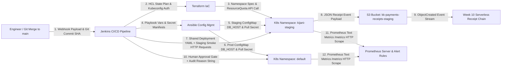

# Capstone Project Scope Document: KijaniKiosk Track A (Infrastructure-First)

## 1. Problem Statement
Prior to this initiative, KijaniKiosk deployed the `kk-payments` microservice directly into a single default Kubernetes namespace without an isolated staging environment, automated pre-production smoke tests, proactive metric alerting, or decoupled environment configuration. Consequently, configuration changes or faulty payment builds risked immediate production outages and dropped customer payment receipts before any automated check could intercept them.

## 2. Selected Track
**Track A: Infrastructure-First** — Extending KijaniKiosk into a multi-environment, Infrastructure-as-Code provisioned, CI/CD-gated, and Prometheus-monitored delivery system integrated with the Week 10 serverless receipt chain.

## 3. In-Scope Components (Five Single-Sentence Deliverables)
1. Provision an isolated `kijani-staging` Kubernetes namespace with resource quotas using Terraform and configure its secrets, ConfigMaps, and receipt storage using Ansible.
2. Deploy `kk-payments` across both `kijani-staging` and `default` (production) namespaces using a single shared Deployment manifest paired with environment-specific ConfigMaps (`DB_HOST` and `RECEIPT_BUCKET` separation).
3. Automate end-to-end delivery via a Jenkins pipeline triggered on merge to `main` that deploys to staging, executes an automated smoke test, and enforces a reason-recording approval gate before production deployment.
4. Integrate the Week 10 serverless receipt chain so staging payment transactions write JSON receipts to `kk-payments-receipts-staging` and trigger automated receipt generation, fraud validation, and customer notification.
5. Configure Prometheus scraping and commit alert rules (`prometheus/alert-rules.yml`) that fire on elevated `kk-payments` error rates, latency spikes, or pod restarts.

## 4. Out-of-Scope Exclusions
* **Multi-Region Cloud Kubernetes Federation:** Excluded because single-cluster namespace isolation (`kijani-staging` vs. `default`) is sufficient to prove configuration parity, RBAC/quota boundaries, and CI/CD promotion without incurring multi-region cloud egress overhead.
* **Live Third-Party Mobile Money Bank Settlement:** Excluded because external telecom and banking sandboxes introduce non-deterministic network throttling during live grading demonstrations; payment processing is validated deterministically up to the S3 receipt bucket and serverless chain boundary.

## 5. Measurable & Live-Demonstrable Success Criteria
1. **Reproducible IaC Provisioning:** Running `terraform apply` and `ansible-playbook` from a clean checkout provisions `kijani-staging` with active resource quotas, pull secrets, and bucket storage in under 60 seconds.
2. **Configuration Parity:** Inspecting running pods in `kijani-staging` and `default` confirms identical container image tags and Deployment specs but distinct `DB_HOST` values (`postgres-staging.kijani-staging.svc.cluster.local` vs. `postgres-prod.default.svc.cluster.local`).
3. **Gated Pipeline & Smoke Test:** Merging to `main` triggers Jenkins to deploy to `kijani-staging`, pass `scripts/smoke-test.sh`, and pause at the Production Approval Gate until an audit reason string is submitted.
4. **Serverless Receipt Chain Execution:** A `POST /pay` request to `kijani-staging` writes `<receiptId>.json` to `kk-payments-receipts-staging` and produces `<receiptId>-notified.json` in `kk-payments-receipts-staging-processed` within 3 seconds.
5. **Fault Alerting:** Triggering a deliberate payment fault increments `kk_payments_errors_total` and trips the `KkPaymentsHighErrorRate` Prometheus alert rule within 15 seconds.

## 6. Architecture Diagram (Every Connection Labeled with Data Flow)

